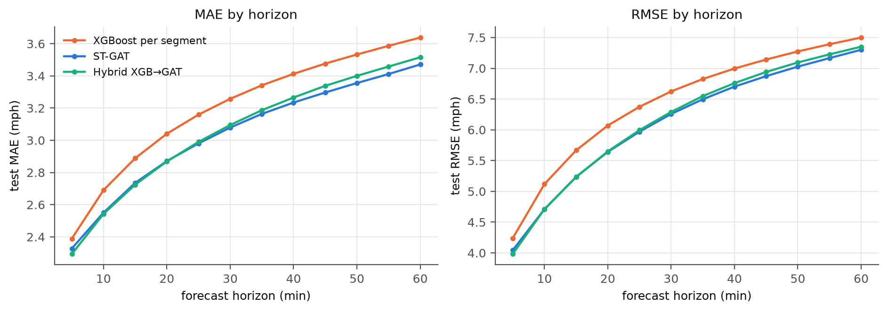
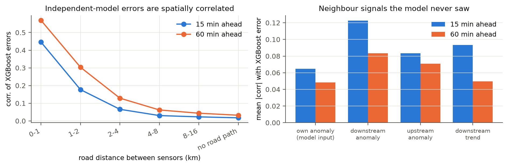
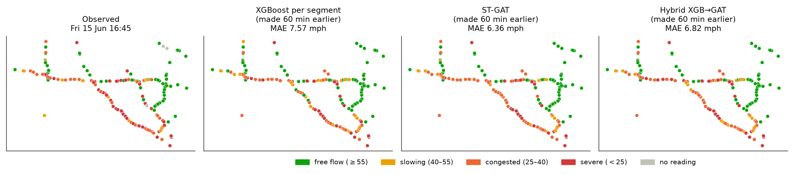

# Traffic flow prediction on METR-LA: graph attention and a hybrid model

We forecast freeway speeds in Los Angeles 5 to 60 minutes ahead at all 207 road sensors of the METR-LA dataset
(March to June 2012, one reading every 5 minutes).

The question is simple: *does learning over the road network beat forecasting each road
segment on its own?* We train three models:

1. **XGBoost per segment**: 207 independent models, one per road sensor.
2. **ST-GAT**: a spatio-temporal graph attention network over the fixed road graph.
3. **Hybrid XGBoost → GAT**: graph attention learns a correction to the XGBoost forecasts.

Signal control is studied by **offline simulation only**; we make no claim of live traffic control.

**Reports:** [project report (PDF, 14 pages)](project_report_phase2/project_report.pdf) ·
[IEEE paper (PDF)](report/main.pdf) · [slides (PDF)](presentation/slides.pdf) ·
[viva notes](docs/viva_notes.md)

## Team

| Name | Enrollment No. |
|---|---|
| Deepanshu | 2401010144 |
| Kanishk Sharma | 2401010207 |
| Adarsh | 2401010026 |
| Daksh Yadav | 2401010139 |
| Hrishabh Prajapati | 2401020027 |

## Results

Test-set error in mph (4–27 June 2012, used once after all design decisions). Every model
sees the same one hour of history; missing readings are not scored.

| Model | 15 min | 30 min | 60 min | Average MAE |
|---|---|---|---|---|
| XGBoost per segment | 2.89 | 3.26 | 3.64 | 3.20 |
| ST-GAT | 2.74 | **3.08** | **3.47** | **3.04** |
| Hybrid XGBoost → GAT | **2.72** | 3.09 | 3.52 | 3.06 |

- **Both network models beat the per-segment models at every horizon** (Diebold-Mariano
  test, p < 0.001). ST-GAT cuts the error by 5% overall and by 6% in peak hours at 60 min.
- **The hybrid is best up to 20 minutes ahead, ST-GAT from 25 minutes on.** At 60 min ST-GAT
  is below the published DCRNN (3.60) and Graph WaveNet (3.53) results on this dataset.
- **Rush hour and congestion** gain the most: at 60 min the peak-hour MAE falls from 5.19
  (XGBoost) to 4.88 (ST-GAT), and on congested readings from 11.79 to 10.66.
- **Simulated signal control:** a controller that switches to a congestion plan using the
  forecasts is already on before 20% (XGBoost), 30% (ST-GAT) and 36% (hybrid) of congestion
  onsets, against 0% for a controller that only reacts to the current speed.

RMSE, MAPE and all 12 horizons are in `results/tables/p2_*.csv`.



## Why a graph?

On out-of-fold *training* errors (no test data), the per-segment XGBoost errors are correlated
between road neighbours (0.21 at 60 min, against 0.04 for unrelated sensors), and the state of
the sensor just **downstream** predicts a model's error better than the sensor's own state.
An independent model cannot use this information; the graph models are built to use it.



## The three models

### 1. XGBoost per segment

- **Inputs:** 37 features of the sensor's own series only: 12 recent speeds, short-term
  changes, last-hour statistics, missing-data flags, time of day and day of week, and the
  sensor's usual speed (from training data) at each of the 12 target times.
- **Model:** one multi-output XGBoost per sensor (one tree predicts all 12 horizons),
  absolute-error loss, depth 6, learning rate 0.1, up to 400 trees with early stopping
  (median 113 trees kept).
- **What it uses:** 57% of the split gain comes from the usual speed at the target time and
  24% from recent speeds.
- Code: `src/traffic/models/segment.py`, `scripts/run_segment_xgb.py`

### 2. ST-GAT

- **Inputs:** 12 steps × 207 sensors × 6 channels: filled-in speed, a 0/1 flag saying
  whether the reading was real (outages are masked, not treated as 0 mph), and sin/cos of
  time of day and day of week; plus a learned embedding per sensor.
- **Architecture:** 1×1 convolution to 64 channels, then two blocks of *gated temporal
  convolution → graph attention → gated temporal convolution → LayerNorm → dropout*, then a
  convolution and an MLP that output all 12 horizons. 163,516 parameters.
- **Graph attention:** each sensor attends separately to its **downstream** and **upstream**
  neighbours on the road graph (4 heads each), because 73% of road edges are one-way and
  traffic jams move backwards. The layer matches PyTorch Geometric's `GATConv` (unit test).
- **Training:** masked MAE loss, AdamW (lr 1e-3, weight decay 1e-4), dropout 0.2, attention
  dropout 0.1, gradient clipping, learning-rate halving, early stopping (up to 40 epochs).
- Code: `src/traffic/models/stgat.py`, `src/traffic/trainer.py`, `scripts/train_deep.py`

### 3. Hybrid XGBoost → GAT

- **Idea:** `forecast = XGBoost forecast + graph-attention correction`.
- **Architecture:** the ST-GAT encoder plus an embedding of all sensors' XGBoost forecasts and
  one more graph attention layer, so a sensor can react to its neighbours' forecasts. The last
  layer starts at zero, so training starts exactly at the XGBoost forecast. 181,052 parameters.
- **Cross-fitting:** the network trains on *out-of-fold* XGBoost forecasts (5 time blocks with
  a gap around each); in-sample forecasts are too good (2.69 vs 2.99 mph) and would teach it to
  trust XGBoost too much.
- **What it does:** the average correction is 0.95 mph, 1.71 mph in peak hours against 0.70
  off-peak, and 3.27 mph on congested readings.
- Code: `STGAT(base_dim=12, residual=True)` in `src/traffic/models/stgat.py`

## Ablation studies

Each variant is trained for the same 12 epochs with the same seed (average test MAE, mph):

| ST-GAT variant | MAE | | Hybrid variant | MAE |
|---|---|---|---|---|
| Full model | **3.08** | | Full hybrid | **3.05** |
| Averaging instead of attention | 3.10 | | XGBoost forecast as input only | 3.07 |
| Attention over all sensor pairs | 3.14 | | Without cross-fitting | 3.14 |
| Without graph layers | 3.20 | | Correction without graph | 3.16 |
| Missing readings fed as 0 mph | 3.23 | | Linear correction | 3.19 |

Masking missing readings and using the road graph matter most; without the graph ST-GAT falls
back to the per-segment level (3.20). In the hybrid, the graph and cross-fitting are both
needed. With this equal budget the hybrid beats ST-GAT at every horizon.

## Dataset and setup

- METR-LA: 207 sensors, 34,272 time steps, 8.1% of readings missing; road graph built from
  road distances (1,515 directed edges).
- Chronological 70/10/20 split (23,974 / 3,425 / 6,850 windows), never shuffled across the
  boundaries.
- Scaler and usual-speed profile fitted on training data only; cyclic time features.
- Missing readings masked in the inputs and left out of the loss and every metric.
- Same 12-step history and 12 horizons for every model; MAE, RMSE and MAPE at every horizon;
  peak (weekdays 06–10, 15–19) vs off-peak; congested (< 40 mph) readings.
- Diebold-Mariano tests with Newey-West variance; 52 unit tests (no feature looks into the
  future, attention respects the road graph, the hybrid starts at XGBoost, and more).



## Running it

```bash
python3 -m venv .venv
source .venv/bin/activate
pip install -r requirements.txt
pip install -e .

pytest                       # 52 tests, about 10 seconds
streamlit run app/app.py     # the web app (uses the trained ST-GAT in checkpoints/)
```

To reproduce the Phase 2 results:

```bash
bash scripts/run_phase2.sh             # XGBoost per segment, ST-GAT, hybrid, ablations
                                       # and evaluation (~6 h on an M3 MacBook)
python scripts/model_details.py        # per-model analysis used in the report
```

`run_phase2.sh` is resumable: it skips any run whose results already exist, so after an
interruption just start it again. Keep the laptop awake while it runs (on a Mac,
`caffeinate -i bash scripts/run_phase2.sh`). Training uses CUDA if available, otherwise
Apple MPS, otherwise CPU. Predictions go to `results/predictions/` (git-ignored, over 1 GB).

To rebuild the PDFs: `cd project_report_phase2 && tectonic project_report.tex`,
`cd report && tectonic main.tex` and `cd presentation && tectonic slides.tex`.

## What's where

```
Dataset/                raw METR-LA files (speeds, sensor ids, locations, road distances)
src/traffic/
  data.py, features.py    loading, chronological split, scaler, adjacency, causal features
  graph.py                road-graph statistics (NetworkX)
  models/segment.py       XGBoost per segment and the cross-fitting folds
  models/stgat.py         graph attention, ST-GAT and the hybrid
  trainer.py, metrics.py  masked inputs, training loop, metrics, DM test
scripts/                run_segment_xgb.py, train_deep.py, run_phase2.sh,
                        evaluate_phase2.py, model_details.py, compare_xgb_strategy.py
tests/                  52 pytest tests
results/                metrics, tables, figures, training history and logs (p2_*)
checkpoints/            trained ST-GAT and hybrid weights
app/                    Streamlit app
project_report_phase2/  project report (LaTeX + PDF)
report/                 IEEE-format paper (LaTeX + PDF)
presentation/           slides (LaTeX + PDF)
docs/                   viva notes and team roles
```

## Phase 2 rubric

| Item | Where |
|---|---|
| Architecture logic | Project report section 5; `src/traffic/models/stgat.py` |
| Hybrid innovation | Project report section 6; `scripts/run_segment_xgb.py` (cross-fitting) |
| Ablation studies | Project report section 7.3; `results/tables/p2_ablation_*.csv` |
| DL literature review | Project report section 2; IEEE paper section II |
| DL dataset and regularisation | Project report sections 3 and 5.4 |
| Technical validation | `results/tables/p2_diebold_mariano.csv`, `p2_bootstrap_ci.csv`, `tests/` |
| Theoretical rigour | The gap equation (report section 4.3), graph attention (section 5.3) |
| GitHub repository and code quality | Package layout, 52 tests, resumable pipeline |
| Presentation | `presentation/slides.pdf`, the app |
| Viva | `docs/viva_notes.md` |
| Report (LaTeX / IEEE) | `project_report_phase2/project_report.pdf`, `report/main.pdf` |

## References

- Li et al., *Diffusion Convolutional Recurrent Neural Network* (DCRNN), ICLR 2018. Source of METR-LA.
- Veličković et al., *Graph Attention Networks*, ICLR 2018. The attention layer of ST-GAT.
- Yu et al., *Spatio-Temporal Graph Convolutional Networks* (STGCN), IJCAI 2018. The block structure of ST-GAT.
- Chen and Guestrin, *XGBoost: A Scalable Tree Boosting System*, KDD 2016.
- Wolpert, *Stacked Generalization*, Neural Networks 1992. The basis of cross-fitting.

The full list is in `report/refs.bib`.
