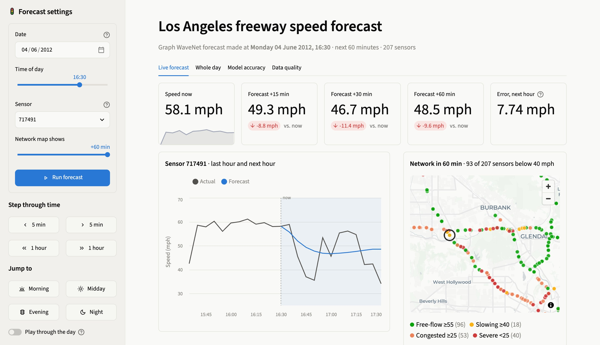

# Traffic speed forecasting on METR-LA

Our Applied ML project. We predict freeway speeds in Los Angeles 5 to 60 minutes
ahead, at 207 road sensors at once, using the METR-LA dataset (March to June 2012,
one reading every 5 minutes).

**Phase 1** built the data pipeline, hand-made features, classical models and Graph
WaveNet. **Phase 2** asks the project's main question: *does learning over the road
network beat forecasting each road segment on its own?* We fit one XGBoost model per
segment, show what it is missing, and then build a graph attention network (ST-GAT)
and a hybrid where graph attention corrects the XGBoost forecasts. There's also a
Streamlit app where you can replay the forecasts on the test period.



## Results

Mean absolute error in mph on the test set (4–27 June 2012). Lower is better.
Missing readings are left out of the score. Every model sees the same one hour of
history.

| Model | 15 min | 30 min | 60 min | Average |
|---|---|---|---|---|
| Historical average | 4.19 | 4.19 | 4.19 | 4.19 |
| Persistence | 3.50 | 4.21 | 5.38 | 4.24 |
| Ridge (our features) | 3.37 | 3.78 | 4.09 | 3.69 |
| Gradient boosting (our features) | 2.89 | 3.29 | 3.66 | 3.22 |
| **XGBoost per segment** (207 independent models) | 2.89 | 3.26 | 3.64 | 3.20 |
| **ST-GAT** (graph attention, ours) | 2.74 | **3.08** | **3.47** | **3.04** |
| **Hybrid XGBoost → GAT** (ours) | **2.72** | 3.09 | 3.52 | 3.06 |

What we found:

- **The road network matters.** The per-segment XGBoost models' errors are correlated
  between neighbouring sensors (0.21 at 60 min, against 0.04 for unrelated sensors),
  and the state of the sensor just *downstream* predicts a model's error better than
  the sensor's own state does. That is information an independent model can't use.
- **Graph attention uses it.** ST-GAT cuts the per-segment error by 5% overall and by
  6% at rush hour (60 min ahead). Both ST-GAT and the hybrid beat the independent
  models at every horizon, with Diebold-Mariano p < 0.001.
- **The hybrid is best at 15 minutes** (2.72), ST-GAT at 30 and 60 minutes (3.08 and
  3.47). At 60 minutes ST-GAT is below the published DCRNN (3.60) and Graph WaveNet
  (3.53) results on the same benchmark.
- **Ablations show where the gain comes from.** With the same short training budget for
  every variant: removing the graph from ST-GAT takes it back to the per-segment level
  (3.08 → 3.20 mph), feeding outages as 0 mph is even worse (3.23), attention over all
  sensor pairs instead of road neighbours costs 0.06, and attention itself adds only 0.02
  over plain neighbour averaging. For the hybrid, the graph (3.05 vs 3.16 without it) and
  cross-fitting (3.05 vs 3.14 without it) are both essential, and at this equal budget the
  hybrid beats ST-GAT at every horizon.
- **Robust to sensor outages.** When a sensor's latest reading is missing, ST-GAT gets
  28% worse at 60 minutes, about as robust as the tabular models with forward-filled
  features (24–32%). Fed the outages as 0 mph instead, it is 0.26 mph worse at 60 minutes.
- **Simulated signal control.** In an offline replay of the test period, a controller
  that switches to a congestion plan based on graph-model forecasts is already switched
  on before 30–36% of congestion onsets, against 20% with the per-segment model and 0%
  for a purely reactive one. This is a simulation only; we don't claim live control.

The full numbers (RMSE, MAPE, peak vs off-peak, significance tests, confidence
intervals, ablations) are in `results/tables/p2_*` and in the report.

## Running it

```bash
python3 -m venv .venv
source .venv/bin/activate
pip install -r requirements.txt
pip install -e .

pytest                       # 52 tests, about 10 seconds
streamlit run app/app.py     # the web app (uses the trained ST-GAT in checkpoints/)
```

To reproduce everything from scratch, run the scripts in this order:

```bash
python scripts/run_eda.py              # EDA figures and stats, ~1 min
python scripts/clean_data.py           # data checks and cleaning, ~15 s
python scripts/run_classical.py        # baselines, ridge, gradient boosting, ~40 min on CPU
bash scripts/run_deep_experiments.sh   # Phase 1 Graph WaveNet, a few hours
python scripts/evaluate.py             # Phase 1 tables and figures
bash scripts/run_phase2.sh             # Phase 2: XGBoost per segment, ST-GAT, hybrid,
                                       # ablations and evaluation (~6 h on an M3)
```

`run_phase2.sh` is resumable: it skips any run whose results already exist, so after
an interruption just start it again. Keep the laptop awake while it runs (on a Mac,
`caffeinate -i bash scripts/run_phase2.sh`); a sleeping machine pauses training.

Training uses CUDA if there is a GPU, otherwise Apple MPS, otherwise CPU. One ST-GAT
epoch takes about a minute on an M3 MacBook (8 GB).

Predictions get written to `results/predictions/`. That folder is git-ignored because
it's over 1 GB, but the scripts recreate it.

## How it works

**Setup.** Each model gets the last hour (12 readings) for every sensor and has to
predict the next hour (12 readings). We split the data by time: the first 70% for
training, the next 10% for tuning, and the last 20% for testing, never shuffling
across those boundaries. This is the same setup the DCRNN and Graph WaveNet papers
use, so our numbers can be compared with theirs.

**Missing data.** About 8% of readings are missing, and the dataset stores them as 0
mph. We never score a model on those. For inputs we only fill gaps with past values,
and the Phase 2 networks also get a 0/1 channel saying whether each reading was real.

**Phase 1 models.** Historical average, persistence, ridge regression and gradient
boosting on 34 hand-made features, and Graph WaveNet (road graph plus a learned
adjacency, dilated convolutions over time).

**XGBoost per segment (Phase 2 baseline).** One model per sensor, using only that
sensor's own history: 12 recent speeds, short-term changes, rolling stats, time of
day and week as sin/cos, and the sensor's usual speed at each target time. One model
predicts all 12 horizons. METR-LA only has speed, so flow and occupancy features
aren't possible here.

**ST-GAT.** Gated convolutions over time, alternating with graph attention over the
fixed road graph. Each sensor attends separately to the sensors downstream and
upstream of it, because traffic jams travel backwards along a road. 164k parameters.

**Hybrid.** The XGBoost forecasts go into ST-GAT, which outputs a *correction* that is
added to them. The last layer starts at zero, so training starts exactly at the
XGBoost forecast. The XGBoost forecasts used for training are out-of-fold (5 time
blocks with a gap around each), so the network learns from errors as large as the
ones it will see at test time.

**Checking the results.** Diebold-Mariano tests with Newey-West variance, bootstrap
confidence intervals that resample whole days, errors by horizon, peak vs off-peak,
congestion and missing inputs, ablations that switch off one design choice at a
time, and 52 unit tests (including a check that our attention layer matches PyTorch
Geometric's `GATConv`, and that no feature looks into the future).

## Data cleaning

`scripts/clean_data.py` checks the raw data and saves a cleaned copy to
`Dataset/cleaned/METR-LA_clean.h5`. That file is git-ignored and takes about 15
seconds to regenerate. What it found:

- All 12 integrity checks passed (timestamps, sensor order, value range, locations, distances).
- 2,148 time steps where every sensor reads 0 at once, so the whole network was down (6.3% of readings).
- Single sensors reading 0 while their neighbours are fine (1.8%).
- 6,142 spikes, caught with a Hampel filter: a reading more than 5 robust SDs and more than 20 mph away from the local median.
- 274 readings from sensors stuck on the same value for over an hour.

Short gaps (up to an hour) are filled by linear interpolation. Longer ones use the
sensor's usual speed for that time of week, taken from the training data only. We
picked this rule by hiding real readings and seeing which method got them back best.
For a 24-hour gap the weekly profile was much better (4.0 vs 8.6 mph error).

The models themselves still train on the raw data with missing values masked. If we
tested on interpolated values, our scores couldn't be compared with the papers. The
cleaned copy is used for the quality report and the figures.

One gotcha: `METR-LA.h5` was written with a very old pandas (0.15), and current pandas
can't read it, so `src/traffic/data.py` reads it directly with h5py.

## What's where

```
Dataset/           raw METR-LA files (speeds, sensor ids, locations, road distances)
src/traffic/       the Python package: data loading, cleaning, features, metrics, training
  models/          baselines, classical, LSTM, Graph WaveNet, segment.py (XGBoost per
                   segment), stgat.py (ST-GAT and the hybrid)
  graph.py         road-graph statistics (NetworkX)
scripts/           one script per step; Phase 2: run_segment_xgb.py, train_deep.py,
                   run_phase2.sh, evaluate_phase2.py, compare_xgb_strategy.py
tests/             pytest tests (leakage, alignment, masking, graph, attention, hybrid)
notebooks/         01_eda.ipynb, the exploratory analysis with notes
results/           metrics, tables, figures, training history and logs (p2_* = Phase 2)
checkpoints/       trained ST-GAT and hybrid weights (and the Phase 1 Graph WaveNet)
app/               the Streamlit app, plus screenshots
report/            IEEE-format LaTeX paper (main.tex, compiled to main.pdf)
presentation/      Phase 2 slides (slides.tex, compiled to slides.pdf)
docs/              viva_notes.md: likely viva questions with short answers
project_report/    shorter plain-language Phase 1 report (project_report.tex / .pdf)
```

To rebuild the PDFs: `cd report && tectonic main.tex`,
`cd presentation && tectonic slides.tex` and
`cd project_report && tectonic project_report.tex`.

## For the Phase 2 evaluation

- Architecture logic: section VI of the paper (`report/sections/deep.tex`), `src/traffic/models/stgat.py`
- Hybrid innovation: section VI-C, `STGAT(base_dim=12, residual=True)`, `scripts/run_segment_xgb.py` (cross-fitted base forecasts)
- Ablation studies: section IX-E, `results/tables/p2_ablation_*.csv`
- Deep learning literature review: section II (`report/sections/related.tex`)
- DL dataset and regularisation: section VI-D, `input_features()` in `src/traffic/trainer.py`
- Technical validation: `results/tables/p2_diebold_mariano.csv`, `p2_bootstrap_ci.csv`, `tests/test_phase2.py`
- Theoretical rigour: Eq. (8) (the gap of independent models) and the attention analysis in section VI-B
- Code quality: package layout, 52 tests, resumable `scripts/run_phase2.sh`
- Presentation: `presentation/slides.pdf` and the app's "Graph attention (Phase 2)" tab
- Viva: `docs/viva_notes.md`
- Report: `report/main.pdf`

## For the Phase 1 evaluation

- Literature review: section II of the paper (`report/sections/related.tex`), with sources in `report/refs.bib`
- Dataset quality and EDA: `notebooks/01_eda.ipynb`, `scripts/run_eda.py`, `scripts/clean_data.py`, the `eda_*` and `clean_*` figures in `results/figures/`
- Feature engineering: `src/traffic/features.py`, plus the ablation and permutation importance results in `results/tables/`
- Theoretical rigour: section V of the paper, and `src/traffic/metrics.py` for the masked metrics and the DM test
- Model application: `src/traffic/models/`, `scripts/run_classical.py`, `scripts/train_deep.py`, `results/metrics/`
- Presentation: `project_report/project_report.pdf` and the app
- Report: `report/main.pdf`

## References

The main papers we built on:

- Li et al., *Diffusion Convolutional Recurrent Neural Network* (DCRNN), ICLR 2018. This is where METR-LA comes from.
- Wu et al., *Graph WaveNet for Deep Spatial-Temporal Graph Modeling*, IJCAI 2019.
- Yu et al., *Spatio-Temporal Graph Convolutional Networks* (STGCN), IJCAI 2018.
- Veličković et al., *Graph Attention Networks*, ICLR 2018. The attention layer of ST-GAT.
- Zhang et al., *CityFlow: A Multi-Agent Reinforcement Learning Environment for Large Scale City Traffic Scenario*, WWW 2019.

The full list is in `report/refs.bib`.
