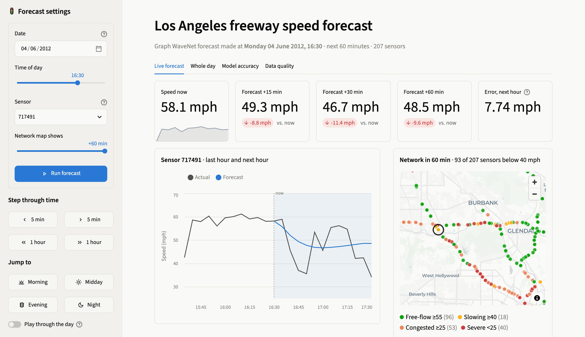

# Traffic speed forecasting on METR-LA

Our Applied ML project. We predict freeway speeds in Los Angeles 5 to 60 minutes
ahead, at 207 road sensors at once, using the METR-LA dataset (March to June 2012,
one reading every 5 minutes).

We started with simple baselines and worked up to Graph WaveNet, a graph neural
network that uses the road network between sensors. Along the way we cleaned the
data, built a set of hand-made features for the classical models, and checked
whether the differences between models are actually significant. There's also a
small Streamlit app where you can replay the forecasts on the test period.



## Results

Mean absolute error in mph on the test set (4–27 June 2012). Lower is better.
Missing readings are left out of the score.

| Model | 15 min | 30 min | 60 min | Average |
|---|---|---|---|---|
| Historical average | 4.19 | 4.19 | 4.19 | 4.19 |
| Persistence | 3.50 | 4.21 | 5.38 | 4.24 |
| Ridge (our features) | 3.37 | 3.78 | 4.09 | 3.69 |
| Gradient boosting (our features) | 2.89 | 3.29 | 3.66 | 3.22 |
| Graph WaveNet | **2.72** | **3.10** | **3.59** | **3.07** |

Graph WaveNet came out best at every horizon, and the Diebold-Mariano tests say the
gap is significant (p < 0.001 against every other model). The original paper reports
3.53 at 60 minutes, so our version is close. What surprised us was gradient
boosting: with decent features it ends up only 0.07 mph behind at 60 minutes and
trains in about 10 minutes on a CPU.

The full numbers (RMSE, MAPE, confidence intervals) are in `results/tables/`.

## Running it

```bash
python3 -m venv .venv
source .venv/bin/activate
pip install -r requirements.txt
pip install -e .

pytest                       # 32 tests, takes a few seconds
streamlit run app/app.py     # the web app
```

The app uses the trained checkpoint in `checkpoints/`, so you don't need to train
anything to try it.

To reproduce everything from scratch, run the scripts in this order:

```bash
python scripts/run_eda.py              # EDA figures and stats, ~1 min
python scripts/clean_data.py           # data checks and cleaning, ~15 s
python scripts/run_classical.py        # baselines, ridge, gradient boosting, ~40 min on CPU
bash scripts/run_deep_experiments.sh   # deep models, a few hours
python scripts/evaluate.py             # tables, significance tests, result figures
```

Training uses CUDA if there is a GPU, otherwise Apple MPS, otherwise CPU. We trained
Graph WaveNet on an M3 MacBook and it took about 2.4 hours. The run stopped at epoch 26
of 35, so the saved model is the best checkpoint up to that point (epoch 25).

Predictions get written to `results/predictions/`. That folder is git-ignored because
it's around 300 MB, but the scripts recreate it.

## How it works

**Setup.** Each model gets the last hour (12 readings) for every sensor and has to
predict the next hour (12 readings). We split the data by time: the first 70% for
training, the next 10% for tuning, and the last 20% for testing. This is the same
setup the DCRNN and Graph WaveNet papers use, so our numbers can be compared with theirs.

**Missing data.** About 8% of readings are missing, and the dataset stores them as 0
mph. We never score a model on those. For the input features we only fill gaps with
past values, so nothing from the future leaks in.

**Features.** The classical models get 34 features in six groups: recent speeds,
rolling stats over the last hour, time of day and day of week, the sensor's usual
speed for that time of week, the speeds just upstream and downstream, and a few fixed
facts about each sensor. The "usual speed for this time of week" group helped the
most. There are tests in `tests/test_features.py` that check no feature looks into the future.

**Models.** Historical average, persistence (speed stays the same), ridge regression,
histogram gradient boosting with one model per horizon, and Graph WaveNet. Graph
WaveNet combines the road graph with an adjacency matrix it learns itself, and uses
dilated convolutions over time.

**Checking the results.** Diebold-Mariano tests with Newey-West variance, bootstrap
confidence intervals that resample whole days, and error broken down by horizon,
hour of day, sensor and missing inputs. The evening rush around 18:00 is by far the
hardest time to predict.

The code also has an LSTM and a Graph WaveNet ablation (no graph, road graph only,
learned graph only) in `scripts/run_deep_experiments.sh`. We didn't finish those runs,
so they aren't in the results above.

## Data cleaning

`scripts/clean_data.py` checks the raw data and saves a cleaned copy to
`Dataset/cleaned/METR-LA_clean.h5`. That file is git-ignored and takes about 15
seconds to regenerate. What it found:

- All 12 integrity checks passed (timestamps, sensor order, value range, locations, distances).
- 2,148 time steps where every sensor reads 0 at once, so the whole network was down (6.3% of readings).
- Single sensors reading 0 while their neighbours are fine (1.8%).
- 6,142 spikes, caught with a Hampel filter: a reading more than 5 robust SDs and more than 20 mph away from the local median.
- 274 readings from sensors stuck on the same value for over an hour.

Short gaps (up to an hour) are filled by linear interpolation. Longer ones use the
sensor's usual speed for that time of week, taken from the training data only. We
picked this rule by hiding real readings and seeing which method got them back best.
For a 24-hour gap the weekly profile was much better (4.0 vs 8.6 mph error).

The models themselves still train on the raw data with missing values masked. If we
tested on interpolated values, our scores couldn't be compared with the papers. The
cleaned copy is used for the quality report, the figures and the app's Data quality tab.

One gotcha: `METR-LA.h5` was written with a very old pandas (0.15), and current pandas
can't read it, so `src/traffic/data.py` reads it directly with h5py.

## What's where

```
Dataset/           raw METR-LA files (speeds, sensor ids, locations, road distances)
src/traffic/       the Python package: data loading, cleaning, features, metrics, models, training
scripts/           one script per step (EDA, cleaning, classical models, deep models, evaluation)
tests/             pytest tests (leakage, alignment, masking, graph, model shapes, cleaning)
notebooks/         01_eda.ipynb, the exploratory analysis with notes
results/           metrics, tables, figures, training history and logs
checkpoints/       trained Graph WaveNet weights
app/               the Streamlit app, plus screenshots
report/            IEEE-format LaTeX paper (main.tex, compiled to main.pdf)
project_report/    shorter plain-language report (project_report.tex / .pdf)
```

To rebuild the PDFs: `cd report && tectonic main.tex` and
`cd project_report && tectonic project_report.tex`.

## For the Phase 1 evaluation

- Literature review: section II of the paper (`report/sections/related.tex`), with sources in `report/refs.bib`
- Dataset quality and EDA: `notebooks/01_eda.ipynb`, `scripts/run_eda.py`, `scripts/clean_data.py`, the `eda_*` and `clean_*` figures in `results/figures/`
- Feature engineering: `src/traffic/features.py`, plus the ablation and permutation importance results in `results/tables/`
- Theoretical rigour: section V of the paper, and `src/traffic/metrics.py` for the masked metrics and the DM test
- Model application: `src/traffic/models/`, `scripts/run_classical.py`, `scripts/train_deep.py`, `results/metrics/`
- Code quality: the package layout, the tests, and one reproducible script per step
- Presentation: `project_report/project_report.pdf` and the app (`streamlit run app/app.py`)
- Report: `report/main.pdf`

## References

The main papers we built on:

- Li et al., *Diffusion Convolutional Recurrent Neural Network* (DCRNN), ICLR 2018. This is where METR-LA comes from.
- Wu et al., *Graph WaveNet for Deep Spatial-Temporal Graph Modeling*, IJCAI 2019.
- Yu et al., *Spatio-Temporal Graph Convolutional Networks* (STGCN), IJCAI 2018.

The full list is in `report/refs.bib`.
